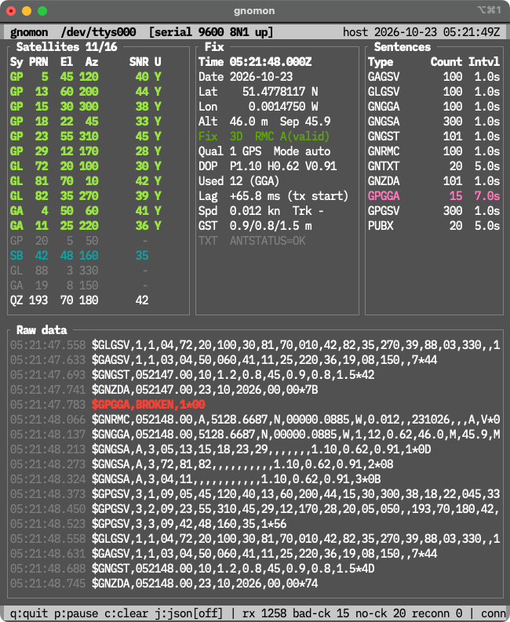
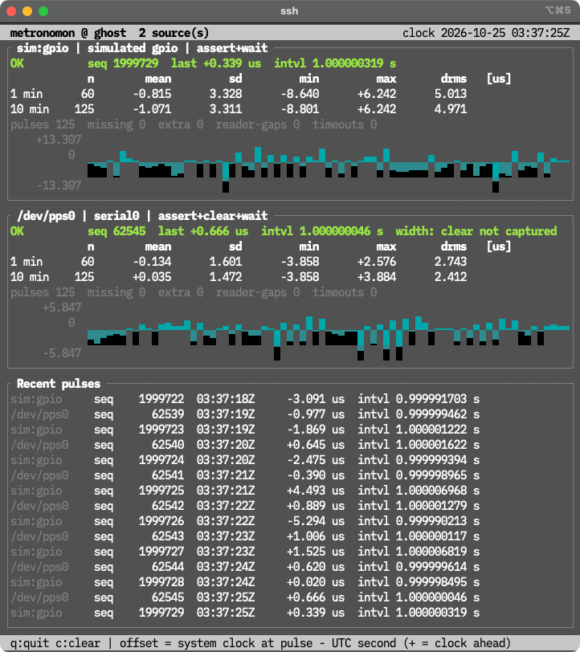

# gnomon

> **gnomon** /ˈnoʊmɒn/ — the part of a sundial that casts the shadow; an instrument
> that reads the time from the sky. Also: **GN**SS **mon**itor.

Terminal tools for people who run NTP servers on GNSS receivers.

There are plenty of GPS viewers. They show where you are and which satellites
are in view. For an NTP server that is the least interesting part. What you
actually need to know is:

- **Is the NMEA output coming out every second?** Every sentence, every epoch,
  nothing dropped, no checksum errors.
- **When does it come out?** How long after the UTC second the receiver
  starts talking, and whether that drifts.
- **Is the PPS steady?** Second by second, not as a filtered average.
- **Is anything missing or extra?** A lost pulse, a glitch, a sentence that
  quietly stopped.

gnomon-gnss answers these with two small commands:

- **`gnomon`** — an NMEA 0183 monitor modelled on `gpsmon` from gpsd. Reads
  from gpsd, from a TCP port carrying raw NMEA (the NMEA output of an NTP
  appliance, a serial-to-TCP bridge), or from a serial port. Shows per-epoch
  output timing (`Lag`), per-sentence intervals and dropouts, alongside the
  usual satellites and fix.
- **`metronomon`** — a pulse-per-second monitor for the Linux PPS API
  (`/dev/ppsN`). Shows every pulse's offset, 1 and 10 minute statistics,
  second-to-second jitter, and missing or extra pulses. It only reads, so it
  runs next to chronyd or ntpd on the same device without disturbing them.

No external crates (std only). Read-only by design: neither tool ever writes
to a receiver.



## Why another tool?

| Tool | Tells you | Does not tell you |
|---|---|---|
| `gpsmon`, `cgps`, vendor GUIs | position, satellites, receiver configuration | when the output arrives, which sentences dropped out |
| `ppstest` | raw PPS timestamps | statistics, missing pulses, trends |
| `chronyc sources` / `ntpq -p` | the filtered result after the servo | what each individual pulse or epoch did |
| **gnomon / metronomon** | output timing, regularity, dropouts and per-pulse jitter, live | (not a replacement for the above) |

Typical uses:

- Evaluating a GNSS receiver or an NTP appliance before putting it into
  service: how late is its NMEA, how clean is its PPS.
- Comparing several PPS sources side by side on one host.
- Checking that a time server's reference is still healthy, over SSH, without
  stopping chronyd, ntpd or gpsd.
- Finding patterns the servo hides: a periodic disturbance, a jitter that
  alternates every second, an occasional lost pulse.

## Install

```sh
cargo install gnomon-gnss
```

Requires Rust 1.80 or later. The crate is published as `gnomon-gnss` (the
name `gnomon` is taken on crates.io); it installs the commands `gnomon` and
`metronomon`.

| | macOS | Linux | BSDs |
|---|---|---|---|
| gnomon (gpsd, TCP, serial) | yes | yes | yes |
| metronomon, `/dev/ppsN` | – | yes | – |
| metronomon, simulated sources | yes | yes | yes |

## Build from source

```sh
cargo build --release
./target/release/gnomon ntp.example.net:4001
./target/release/metronomon /dev/pps0
```

For a Raspberry Pi and similar, build on the target itself, or cross-compile,
e.g. `cargo zigbuild --release --target aarch64-unknown-linux-gnu` from macOS.

## gnomon

### Usage

```
gnomon [options] [target]

target (default localhost:2947):
  host[:port]            auto-detect gpsd JSON or raw NMEA
  host:port:/dev/ttyX    gpsd, watch only that device
  [ipv6]:port            IPv6 literal
  tcp://host:port        raw NMEA only (never writes to the peer)
  gpsd://host[:port]     gpsd only
  /dev/ttyXXX            serial port (on macOS use /dev/cu.*)

options:
  -r, --raw              treat the target as raw NMEA (same as tcp://)
  -g, --gpsd             treat the target as gpsd
  -s, --speed BPS        serial speed (default: auto-detect)
  -l, --log FILE         append every received byte to FILE
  -f, --replay FILE      play back a capture, paced at 1 epoch/s by sentence time
                         ('-' reads stdin, unpaced)
  -a, --ascii            ASCII box drawing (for terminals treating ambiguous
                         width as double)
  -j, --json             show gpsd JSON in the raw window from the start
      --snapshot SECS    no TUI: receive for SECS seconds, print one screen as
                         text and exit
      --size WxH         screen size for --snapshot (default 100x40)
```

Keys: `q` quit / `p` (or space) pause the raw window / `c` clear statistics /
`j` toggle JSON lines

### Protocol auto-detection

Decided by the first non-whitespace byte received after connecting:

- `{` → gpsd (VERSION banner). Sends
  `?WATCH={"enable":true,"json":true,"raw":1,"pps":true}`
- `$` / `!` → raw NMEA. Nothing is ever written to the peer.
- Nothing received: only on port 2947 is the peer assumed to be gpsd after
  2 seconds and sent a WATCH. On any other port gnomon keeps waiting without
  writing, so that no junk ever reaches a GNSS receiver's serial input.

After 15 seconds without data, or on disconnect, it reconnects automatically
(back-off 1→2→4→8 s, reset once data is received).

### Serial input

```sh
gnomon /dev/ttyAMA0              # auto-detect speed
gnomon -s 115200 /dev/ttyUSB0    # fixed speed
gnomon /dev/cu.usbserial-110     # macOS
```

- 8N1, raw, no flow control, **`CLOCAL`** (carrier detect ignored, the
  equivalent of kermit's `SET CARRIER-WATCH OFF`), `HUPCL` off, VMIN=0/VTIME=5.
  termios is driven directly (`src/tty.rs`, with the struct defined separately
  for Linux, macOS and the BSDs), and `CLOCAL` and the speed are read back and
  verified after setting.
- Opened with `O_NONBLOCK` so that open(2) itself never waits for DCD, then
  `CLOCAL` is set, then the descriptor is switched back to blocking. The
  connection status shows the DCD state (`DCD off (ignored)` etc.).
- Opened exclusively with `TIOCEXCL` (gpsd and others can no longer open the
  port; a process that already has it open is not evicted).
- Speed auto-detection tries 9600, 115200, 38400, 4800, 19200, 57600, 230400,
  2.5 s each, and picks the first speed that yields two sentences with valid
  checksums. On reconnect, the last good speed is tried first.
- The input buffer is discarded with `tcflush` right after opening and after
  every speed change, so stale lines are never shown with fresh timestamps.
- Unplugging a USB serial adapter is detected as a read error; gnomon keeps
  trying to reopen the port.
- Nothing is ever written to the receiver.
- **Do not open a device that gpsd is using.** Both would read from it, steal
  bytes from each other, and both would see corrupted data. gnomon also
  changes the line settings, so gpsd may need a restart afterwards.
- On a serial port, line times are back-dated to the first byte on the wire
  (see `Lag (tx start)` below). **USB CDC-ACM devices** (macOS
  `cu.usbmodem*`, Linux `ttyACM*`; u-blox and other receivers with native
  USB) have only a nominal baud rate and deliver data in USB transfers, so
  there the arrival time is used as-is; the header shows `serial USB CDC`.

### Screen

- **Satellites**: system / PRN / elevation / azimuth / C/N0 / used in fix.
  With NMEA 4.10+, C/N0 per GSV signal ID is shown separated by `/`.
  The system is taken from the GSA system ID (field 18) when present, otherwise
  from the talker, and from the PRN range for the GN talker. SBAS (33-64,
  120-158) and QZSS (193-202, or 93-99 as sent by some receivers) reported
  under the GPS talker are shown as their own systems.
- **Fix**: merged from RMC/GGA/GNS/GLL/ZDA/VTG/GSA/GST/TXT, plus **Lag**:
  the time the first time-bearing sentence of each epoch reached the host,
  minus the UTC time in that sentence. It is the sum of the receiver's output
  delay, transport delay and host clock error. Two variants:
  - `Lag (host-fix)`: network, gpsd and USB CDC sources. The arrival time is
    used as-is.
  - `Lag (tx start)`: serial ports. The moment the line's first byte went out
    on the wire is estimated as "chunk arrival time − bytes that followed ×
    10 bits / speed", so the value is close to when the receiver started
    sending the epoch (the latency timer of a USB serial adapter, 16 ms by
    default for FTDI, still remains). Estimated line times are clamped to be
    monotonic.
- **Sentences**: count and output interval (Intvl) per address. The interval is
  an EWMA of arrival intervals measured per NMEA epoch (a change of the time in
  RMC/GGA etc.), so sentences such as GSV that arrive several times per epoch
  count once. When a sentence is missing for 3× its interval (at least 3 s),
  the elapsed seconds are shown in yellow as `12s!`. Sentences that never
  established an interval (seen in only one epoch, such as start-up GPTXT
  banners) are not treated as missing. Shown in red if any checksum failed.
- **gpsd** (gpsd connections only): VERSION, DEVICES, TPV, and
  `real − clock` from PPS / TOFF (PPS in µs, TOFF in ms; positive means the
  system clock is behind).
- **Raw data**: raw lines with host receive time (UTC, ms). Lines without a
  checksum are yellow, lines with a bad checksum red.

For a field-by-field reference (sentence sources, codes, colours), see
[docs/gnomon.md](https://github.com/tanyorg/gnomon/blob/main/docs/gnomon.md).

### Differences from gpsd's gpsmon

- NMEA 0183 only. No per-driver panels for binary protocols such as UBX, SiRF
  or TSIP.
- No commands are sent to the device (no receiver baud-rate changes, output
  configuration, etc.).
- With gpsd, `raw:1` is used, so binary protocols only appear as hex lines in
  the raw window.

## metronomon

`metronomon` watches pulse-per-second signals through the Linux PPS API
(RFC 2783) and shows how steady the beat is.

```sh
metronomon                         # /dev/pps0
metronomon /dev/pps0 /dev/pps1     # several sources side by side (up to 8)
metronomon sim:gpio sim:bad        # simulated sources (any OS)
```



### Usage

```
metronomon [options] [source ...]

source (default /dev/pps0):
  /dev/ppsN              Linux PPS API device (RFC 2783); read-only and
                         non-destructive, safe to run next to chronyd/ntpd
  sim[:PROFILE]          simulated source: gpio (default), uart, usb, bad

options:
  -a, --ascii            ASCII drawing (for ambiguous-width terminals)
      --snapshot SECS    no TUI: run SECS seconds, print one screen, exit
      --size WxH         canvas size for --snapshot (default 100x40)
  -h, --help             this help
  -V, --version          version
```

Keys: `q` quit / `c` clear statistics

### Reading the screen

- **offset** = the system clock reading at the pulse minus the nearest UTC
  second (positive: the system clock is ahead). Reading uses `PPS_FETCH`,
  which is non-destructive, so metronomon runs next to chronyd or ntpd.
- Statistics over 1 and 10 minutes: n, mean, sd, min, max and `drms` (RMS of
  second-to-second differences; about sd × √2 for white noise).
- Counters for **missing** seconds, **extra** pulses (more than 100 ms from
  the recent median), reader gaps and timeouts, and a sparkline of the
  per-second offsets.
- The header shows the host name, so screenshots from several machines can be
  told apart.

For the full reference (thresholds, how to read drms against sd, sparkline
scale, colours, permissions, simulated sources), see
[docs/metronomon.md](https://github.com/tanyorg/gnomon/blob/main/docs/metronomon.md).

## Tested with

| Device | Connection | Host | Tool | Notes |
|---|---|---|---|---|
| u-blox 7 | USB CDC-ACM (`/dev/cu.usbmodem*`) | macOS 15 | gnomon | |
| GT-502MGG-N | gpsd 3.22 (protocol 3.14), receiver on UART (`/dev/ttyAMA0`) at 115200 | Raspberry Pi 3, Debian 11 (aarch64) | gnomon | run on the same host as gpsd (`localhost:2947`) |
| GT-502MGG-N PPS | pps-gpio on GPIO12 (`/dev/pps0`, also via the `/dev/gpspps0` symlink) | Raspberry Pi 3, Debian 11 (aarch64) | metronomon | runs alongside chronyd 4.0 using the same device as a PPS refclock |
| TF-NTP-LITE PPS output | DCD of the PC's built-in UART (`/dev/pps0`) | x86_64 PC (Celeron N2840), Ubuntu 24.04 | metronomon | runs alongside chronyd using the same device; `/dev/pps0` is root-only here, so run with sudo |
| FC-NTP-MINI (NMEA output) | raw NMEA over TCP (port 4001) | OpenBSD 7.9 (amd64, VM) | gnomon | |
| SEIKO TS-2560 (NMEA output) | serial via USB-serial adapter, 115200 8N1 | macOS 15 | gnomon | GSA carries 16 PRN slots plus the NMEA 4.10 system ID |

Reports for other receivers, NTP appliances and operating systems are
welcome: open an issue with the device model, how it is connected, the host
OS, and if possible a short raw NMEA capture.

## Acknowledgements

gnomon would not exist without [gpsd](https://gpsd.io/). For three decades
gpsd has been the quiet, dependable piece that sits between GNSS receivers and
everything else, and `gpsmon` in particular set the pattern this tool follows:
a plain terminal screen that shows exactly what the receiver is saying.

Our sincere thanks and respect go to Remco Treffkorn, who started gpsd in 1995,
and Derrick J. Brashear; to Russ Nelson, who maintained it in its early years;
to Eric S. Raymond, who rewrote it in 2004–2005 and designed the JSON protocol
that gnomon speaks; to Chris Kuethe and Gary E. Miller; and to the many other
contributors who have kept gpsd running on countless receivers, NTP servers
and embedded systems around the world. gpsd's documentation, notably
*NMEA Revealed*, remains an invaluable reference for anyone who has to make
sense of NMEA 0183 as it is actually spoken by real hardware.

Any mistakes in gnomon are entirely our own.

## License

BSD-2-Clause, to match gpsd. The code is a new implementation modelled on the
behaviour of gpsmon and contains no gpsd source code.
